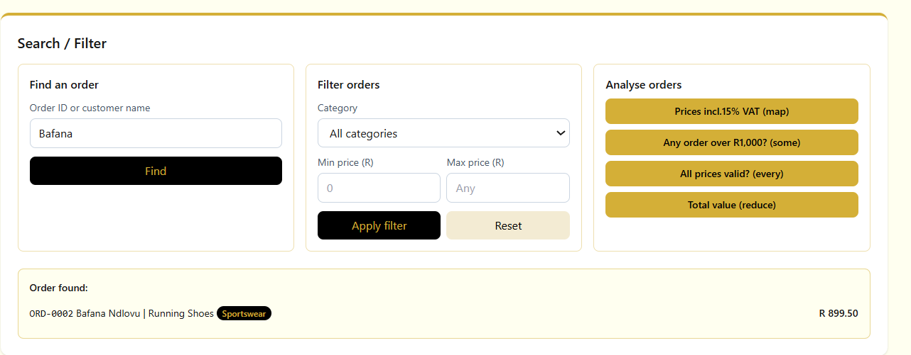
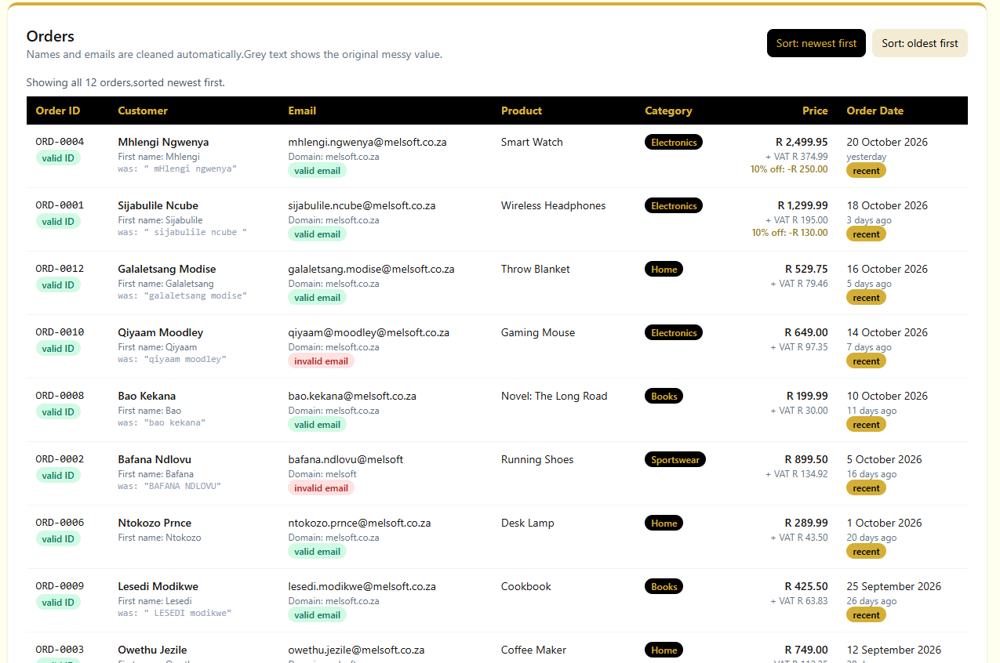
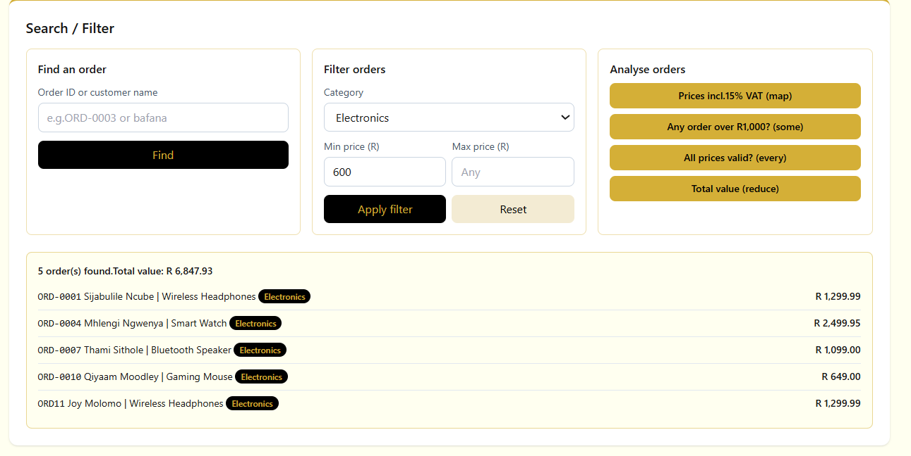
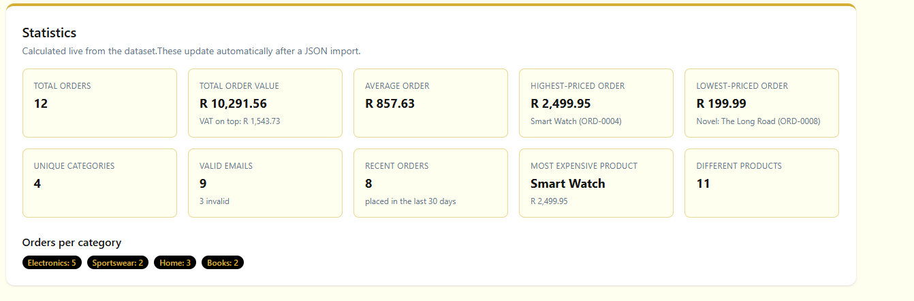
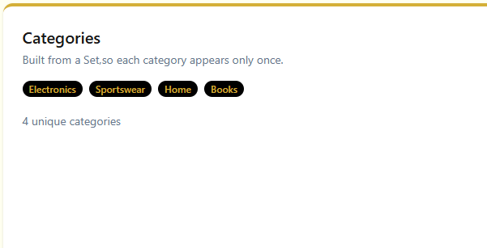
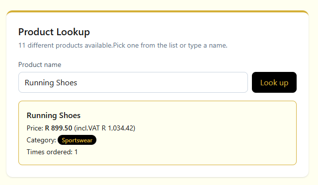
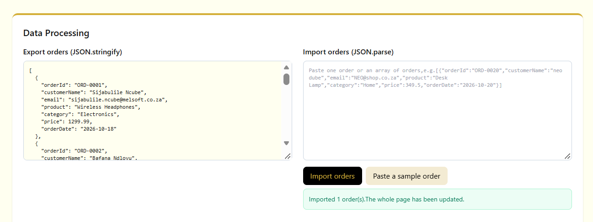
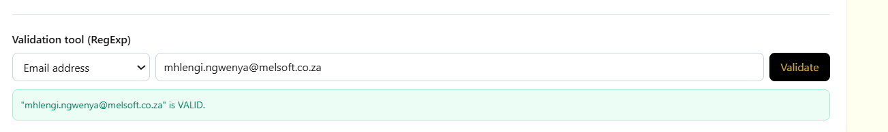

# E-Commerce Order Processor

## Project Description

A browser-based tool that a small online store could use to clean,analyse and report on its orders.It starts with a deliberately messy set of 12 orders (extra spaces,random capitals,invalid emails,a price stored as text,a badly formatted order ID) and automatically:

- cleans customer names and emails
- formats prices,works out VAT and discounts,and calculates totals
- turns raw dates into readable dates,sorts orders and marks recent ones
- lets you search,filter and analyse the orders
- lists unique categories and lets you look up any product instantly
- exports the orders as JSON and imports new orders from JSON
- validates emails and order IDs with regular expressions
- shows a live statistics dashboard that updates whenever the data changes

Everything runs in the browser.There's no backend or database.

## Technologies

- HTML
- Tailwind CSS (Play CDN,used for all styling,no custom CSS)
- JavaScript

## Built-In Objects Used

| Built-in | Where it's used | Methods / features |
|---|---|---|
| **String** | Cleaning names and emails,getting the first name and email domain (`removeExtraSpaces`,`formatName`,`cleanEmail`,`getFirstName`,`getEmailDomain`) | `trim()`,`replace()`,`split()`,`slice()`,`toUpperCase()`,`toLowerCase()`,`includes()`,`charAt()` |
| **Number** | Converting the text price `"289.99"` to a number and formatting money (`toPrice`,`formatRand`) | `parseFloat()`,`toFixed()`,`Number.isFinite()`,`Number.isNaN()` |
| **Math** | Rounding to cents,average,highest and lowest price,VAT and discount (`calculateVat`,`calculateDiscount`,`renderStatistics`) | `Math.round()`,`Math.max()`,`Math.min()`,`Math.abs()` |
| **Date** | Parsing order dates,readable dates,sorting newest/oldest,"days ago" and recent orders (`parseOrderDate`,`formatReadableDate`,`daysAgo`,`renderOrders`) | `new Date()`,`getTime()`,`getFullYear()`,`getMonth()`,`getDate()`,`toLocaleDateString()` |
| **Array** | Search,filter and analyse section,plus rendering every list (`findOrder`,`filterOrders`,`showVatPrices`,`checkAnyOver`,`checkAllValid`,`showTotal`) | `find()`,`filter()`,`map()`,`some()`,`every()`,`reduce()`,`sort()`,`push()` |
| **Set** | Unique categories list and the category filter dropdown (`getUniqueCategories`,`renderCategories`) | `new Set()`,`size`,`has()`,spread `[...set]` |
| **Map** | Product lookup by name (`buildProductMap`,`lookUpProduct`,`renderProductOptions`) | `set()`,`get()`,`has()`,`keys()`,`size` |
| **JSON** | Exporting and importing orders (`renderExport`,`importOrders`,`pasteSampleOrder`) | `JSON.stringify()`,`JSON.parse()` with `try/catch` |
| **RegExp** | Validating emails and order IDs in the table and in the validation tool (`EMAIL_PATTERN`,`ORDER_ID_PATTERN`,`validateValue`) | `test()`,also `replace()` with a pattern for spaces and thousand separators |

## How to Run

1.Clone or download this repository.
2.Open `index.html` in any modern browser (Chrome,Edge,Firefox).You can also use the **Live Server** extension in VS Code.
3.An internet connection is needed the first time so the Tailwind CDN can load.

No installation or build step is needed.

## Project Structure

```
ecommerce-order-processor/
├── index.html          page layout and the six sections
├── script.js           all the JavaScript (data,cleaning,calculations,rendering,events)
├── assets/
│   └── screenshots/    screenshots used in this README
└── README.md
```

## Screenshots

**Orders displayed (cleaned names and emails,validation badges)**


**Date processing (readable dates,days ago,recent badges,sorting)**


**Searching and filtering**


**Calculated statistics**


**Unique categories**


**Product lookup**


**JSON export and import**


**Validation tool**


## Reflection

**1.Which built-in JavaScript object did you find most useful?**
Array,by far.`filter()`,`map()` and `reduce()` ended up in almost every part of the app,from the search section to the statistics dashboard.Once I got used to chaining them,things like "only Electronics orders between R700 and R2,000,then add up their prices" became one readable line instead of a loop full of if statements.

**2.Which challenge was the most difficult?**
Challenge 3 (dates).My first version used `new Date("2026-10-18")`,and some dates showed up a day early.It turns out that format is read as midnight UTC,not local time.Building the date from its parts with `new Date(year,month - 1,day)` fixed it,and I also had to remember that JavaScript months start at 0.Working out "days ago" properly also meant comparing against today at midnight,not the current time.

**3.What did you learn about choosing the right JavaScript method for a problem?**
That there's usually a built-in that already does exactly what I need,and using it makes the code shorter and clearer about my intention.A Set says "unique values" without me writing a duplicate check,a Map says "look this up by name",and `some()` says "is there at least one?" and even stops early.Picking the right one also means another developer can understand the code just from the method name.

**4.If you had more time,what would you improve about the application?**
I'd save the orders in `localStorage` so imported orders survive a page refresh,add buttons to edit or delete an order,and add a chart of sales per category.I'd also store prices in cents behind the scenes to avoid floating point rounding issues completely.
